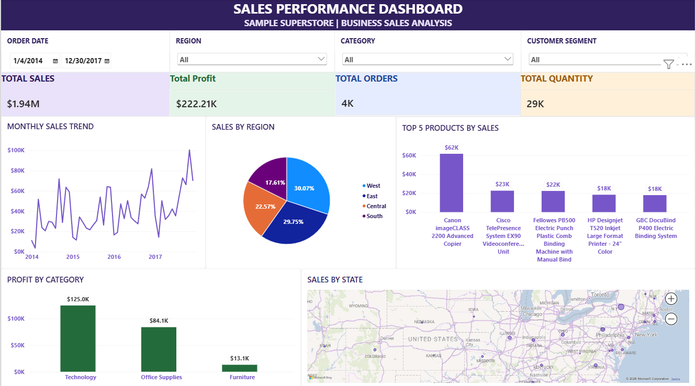

# 📊 Sample Superstore Sales Analysis – Power BI Dashboard

## 📌 Project Overview

This project presents an interactive **Sales Performance Dashboard** developed using Microsoft Power BI and the Sample Superstore dataset.

The dashboard helps analyze sales performance, profitability, orders, product quantity, and regional trends to support data-driven business decisions.

## 📊 Dashboard Preview

## 🎯 Key Performance Indicators (KPIs)

- **Total Sales** – Overall sales generated.
- **Total Profit** – Overall profit earned.
- **Total Quantity** – Total products sold.
- **Total Orders** – Number of unique orders.

## 📈 Dashboard Visualizations

- Monthly Sales Trend
- Sales by Region
- Top 5 Products by Sales
- Sales by State
- Profit by Category

## 🎛️ Interactive Filters

- Order Date
- Region
- Category
- Customer Segment

## 🛠️ Tools & Technologies

- Microsoft Power BI
- Power Query
- DAX (Data Analysis Expressions)
- Data Cleaning and Transformation
- Data Modeling
- Data Visualization

## 📂 Dataset Source

The Sample Superstore dataset is sourced from Kaggle.

**Dataset:** [Sample Superstore Dataset – Kaggle](https://www.kaggle.com/datasets/vivek468/superstore-dataset-final)

The original CSV dataset is not included in this repository. You can download it directly from the Kaggle source.

## 📁 Project Files

| File | Description |
|---|---|
| `Sample_Superstore_Sales_Analysis.pbix` | Interactive Power BI dashboard |
| `Sample_Superstore_Dashboard.png` | Dashboard preview image |
| `README.md` | Project documentation |

## 💡 Skills Demonstrated

- Data Cleaning and Transformation
- Data Analysis
- Data Modeling
- DAX Measures
- KPI Development
- Interactive Dashboard Design
- Business Intelligence
- Data Visualization

## 👨‍💻 Author

**Adrushagoud Patil**

Aspiring Data Analyst | Power BI | SQL | Python | Excel

**GitHub Profile:** [Adrushagoud-Patil](https://github.com/Adrushagoud-Patil)

**Project Repository:** [Sample Superstore Sales Analysis](https://github.com/Adrushagoud-Patil/Sample-Superstore-Sales-Analysis)
