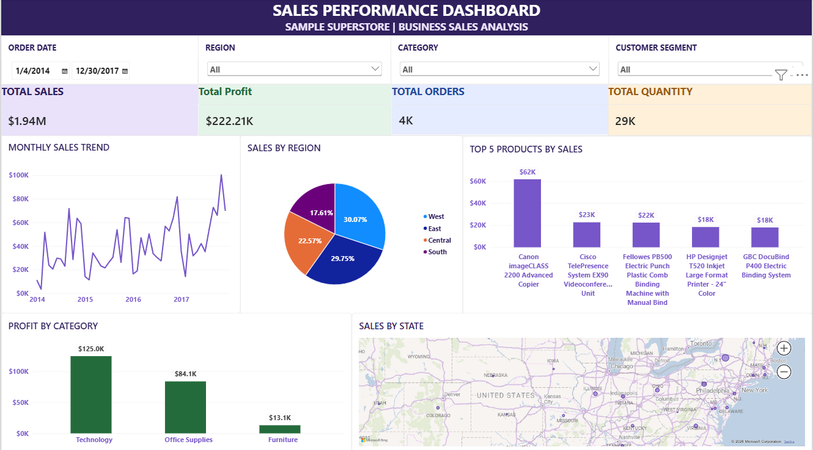

# 📊 Sales Performance Dashboard – Power BI

## 📌 Project Overview

This project presents an interactive Sales Performance Dashboard developed using Microsoft Power BI and the Sample Superstore dataset.

The dashboard provides insights into sales, profit, orders, product quantity, product performance, and regional sales trends to support data-driven business decisions.

## 📊 Dashboard Preview

## 🎯 Key Performance Indicators (KPIs)

- **Total Sales** – Overall sales generated.
- **Total Profit** – Overall profit earned.
- **Total Orders** – Number of unique orders.
- **Total Quantity** – Total products sold.

## 📈 Dashboard Visualizations

- Monthly Sales Trend
- Sales by Region
- Top 5 Products by Sales
- Sales by State
- Profit by Category

## 🎛️ Interactive Filters

- Order Date
- Region
- Category
- Customer Segment

## 🛠️ Tools & Technologies

- Microsoft Power BI
- Power Query
- DAX (Data Analysis Expressions)
- Data Cleaning and Transformation
- Data Modeling
- Data Visualization

## 📂 Dataset Source

The Sample Superstore dataset is sourced from Kaggle.

**Dataset:** [Sample Superstore Dataset – Kaggle](https://www.kaggle.com/datasets/vivek468/superstore-dataset-final)

The original CSV dataset is not included in this repository. Please download it from the Kaggle source.

## 📁 Project Files

| File | Description |
|---|---|
| `Sample_Superstore_Sales_Analysis.pbix` | Interactive Power BI dashboard |
| `Sample_Superstore_Dashboard.png` | Dashboard preview |
| `README.md` | Project documentation |

## 💡 Skills Demonstrated

- Data Cleaning and Transformation
- Data Analysis
- Data Modeling
- DAX Measures
- KPI Development
- Dashboard Design
- Interactive Data Visualization
- Business Intelligence

## 👨‍💻 Author

**Adrushagoud Patil**

Aspiring Data Analyst | Power BI | SQL | Python | Excel

[GitHub Profile](https://github.com/Adrushagoud-Patil)

[Project Repository](https://github.com/Adrushagoud-Patil/Sample-Superstore-Sales-Analysis)
